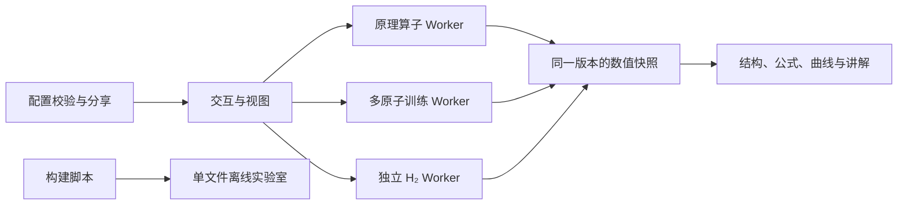

# MLIP 方法交互实验室 v5.1 · 能量与力（2026-11-11）

[在线演示](https://hang-999.github.io/h2-potential-lab/) · [源码](https://github.com/hang-999/h2-potential-lab) · [保留的 v4](https://github.com/hang-999/h2-potential-lab/tree/archive/v4-20261106)

面向研究生方法课的交互网站：从手工描述符到等变图神经网络。每章可切换“原理观察”和“真实训练实验”，同时查看原子构型、公式、预测与一次参数更新。原 H₂ 训练实验室独立保留。

「交互阅读馆」提供 Distill 图神经网络入门和 PAIR 语言模型文章的中英文版本。两版共享作者的交互组件和数据。阅读馆资源位于 `reading/`，在本地用 `npm run serve` 打开；见[阅读馆说明](reading-src/README.md)。

v5.1 增加 H₂ 解析力曲线、能量与力联合训练、覆盖区与外推对照，以及可分享的实验配置；重排顶部导航并明确初始化状态。计算约定见[能量与力说明](ENERGY_FORCE.md)，验证结果见[V5.1 验收报告](VALIDATION-V5.1.md)。阅读馆及原有模型资源沿用既有版本。

**English overview.** An interactive, browser-local laboratory for machine-learning interatomic potentials, from fixed descriptors to equivariant message passing. H₂ supports analytic energy derivatives, optional energy–force joint training, extrapolation experiments and frozen comparisons. Seven multi-atom teaching models retain real energy training. All laboratory chapters run offline in one HTML file; the reading library has separate assets, and some Distill components require internet access. Custom PAIR inputs require the optional local model service. See [contributing](CONTRIBUTING.md), [numerical conventions](ENERGY_FORCE.md), and [API](API.md).

## 离线使用与分发

下载根目录 **index.html**，双击在桌面 Chrome / Edge 中打开方法和训练章节。文件已内嵌脚本、样式、Three.js、H₂ 页面与 Worker。实验室单文件可独立离线分发。交互阅读馆需另附 `reading/` 目录并通过本地预览服务打开。部分 Distill 图表、公式库及分子模型仍依赖外部资源，需要联网；PAIR 预置结果随项目提供，自定义句子需另行启动本地模型服务。详见[阅读馆运行条件](reading-src/README.md)。

GitHub Pages 托管静态网页，GitHub Actions 构建与测试。**训练和数值计算使用访问者本地 CPU**；三维绘图通常使用本地图形硬件。没有 WebGL 时保留可操作的 SVG 投影、公式与数值。

## 从哪里开始

| 入口 | 原理与训练内容 |
| --- | --- |
| `#/map` | 方法分支地图；表示与回归器分开理解 |
| `#/h2` | H₂ Morse 经验势拟合，保留网络设置、四阶段讲解与导出 |
| `#/reading` | 中英双版交互文章，GNN 消息传递与 BERT 填空预测 |
| `#/symmetry` | 几何与变换；训练模式进入可选模型实验 |
| `#/acsf?mode=train` | ACSF → 元素分支网络 → 原子贡献求和 |
| `#/soap?mode=train` | SOAP → 结构核 → 核岭回归系数求解 |
| `#/moments?mode=train` | 径向矩与不变量 → 线性系数学习 |
| `#/messages?mode=train` | 可学习标量消息、聚合与节点更新 |
| `#/vectors?mode=train` | PaiNN 思想：标量、向量和门控 |
| `#/harmonics?mode=train` | NequIP 思想：0e / 1o / 2e 张量消息 |
| `#/mace?mode=train` | MACE 思想：可学习密度与高阶关联 |

移除 `?mode=train` 可进入原理观察。相机旋转与输入坐标变换分开控制；原子标签避让，未显示标签的原子仍可从列表选择。窄窗口使用 A/B 切换代替两个过小的对照图。

建议先完成“准备下一次更新 → 前向 → 损失 → 梯度 → 提交”，再开始连续训练。前三阶段不改模型，提交仅更新一次；回放读取冻结记录。SOAP 使用核求解阶段与迭代计数，不套用神经网络的 Batch / Epoch。

## 三个训练案例

- **A：三原子伸缩与弯曲。** 水形几何、两个 Morse 伸缩项与角弯曲项。
- **B：四配位团簇。** 四面体 C＋4H 的随机伸缩与弯曲，参考为平滑 pair＋angle 势。
- **C：高阶角关联。** 在 B 上增加三个邻居方向内积的乘积项。

参考数据都是明确公式生成的**教学构造势，非 DFT 数据**。默认 160 个构型、128/32 训练／验证划分、种子 42；神经模型默认 Adam、学习率 0.003、Batch 8、300 Epoch。内部消息、嵌入、门控和读出参数参与真实优化，不只训练最后一层。SOAP 学习核系数，线性模型学习全部基系数。

能量切片固定其他自由度，不能代表整个多维势能面。全验证集散点图和 RMSE / MAE 另行显示；验证构型不参与梯度或标准化统计。图线允许局部变差，不使用预设下降曲线。

多原子案例只训练能量。其参考力来自解析梯度，按需计算的预测力来自能量中心差分。H₂ 可选择仅能量或能量＋力训练，其预测力直接由网络输入导数得到。潜在向量不是力，原子贡献是模型数学分解。小模型用于讲解，**不是完整工业 BPNN、SchNet、PaiNN、NequIP 或 MACE 实现**。

公式、范围、核目标及边界见 [TRAINING.md](TRAINING.md)、[SCIENCE.md](SCIENCE.md)、[NUMERICS.md](NUMERICS.md)。来源见 [REFERENCES.md](REFERENCES.md)；综述 PDF 不在分发包中。

## 配置和结果

编辑模型或数据设置后先暂停，点击“应用并重新初始化”生效。相机、探针、速度和布局不清除训练；切换章节暂停并保留页面会话中的模型，刷新网页不恢复权重。

训练配置为 `mlip-training-config` v1，原理配置仍为 `mlip-methods-config` v1，H₂ 配置为 `h2-lab-config` v2，并兼容 v1。配置与实验链接只保存设置，不保存训练权重或训练进度；原理页的可调示例系数属于实验设置。分享使用已应用配置；打开链接后先查看摘要，再应用，保持暂停。H₂ CSV 在原有能量列后增加参考力、预测力、力残差及模型 Step。

## 开发、测试与发布

开发使用 Node.js 24 与 npm；运行成品不需要开发环境。

```sh
npm ci
npm test
npm run build
npm run serve
```

预览地址为 `http://127.0.0.1:4185`。端口占用时，可通过 `MLIP_PREVIEW_PORT` 指定其他本地端口。依赖由 lockfile 锁定，构建结果为自包含单文件。

`operators.js` 与 `methods-worker.js` 保留原理算子；`training-data.js`、`training-models.js`、`training-engine.js`、`training-worker.js` 实现真实训练；`training-ui.js` 与 `scene.js` 负责交互；`h2/` 保留独立 H₂ 引擎。接口见 [API.md](API.md)，三维约定见 [SCENE.md](SCENE.md)。



测试覆盖原有六组检查、新模型梯度与对称性、数据与事务、Worker 和默认收敛。实际结果与浏览器验收范围见 [VALIDATION.md](VALIDATION.md)。独立参考样例随源码保存；`generate-reference.py` 仅用于开发者重建 NumPy 参考，不是运行依赖。

main 推送后，Actions 通过测试与可复现构建才部署 Pages，产物仅包含网页。旧 [v3.1 提交](https://github.com/hang-999/h2-potential-lab/tree/2597ffbc626e2b3c6dcf7a89e74bb39ee430e232)与 [v4 归档分支](https://github.com/hang-999/h2-potential-lab/tree/archive/v4-20261106)可继续查看。

本版修复详情与验证范围见 [本版修复与验收](本版修复与验收.md)。原理与训练共享连续 SOAP 归一化；本地阅读馆不会自动转发自定义句子至远端。
